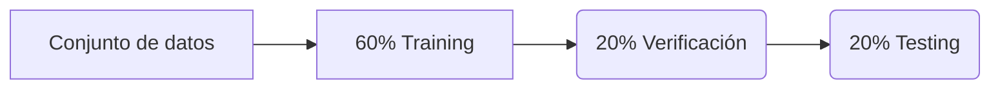

# Machine learning

# Regresión lineal y logística

Lineal: aquella con datos continuos

Logística: La que representa valores discretos (SI, NO)

$$
h_\theta(x) = \theta_0 + \theta_1 x
$$

## Función de coste y optimización

Se calcula para minimizar el error entre los parámetros de entrada. La función hipótesis final es el modelo que se usa para las predicciones.

La función de coste se usa para optimizar los parámetros Teta0 y Teta1 hasta encontrar la aproximación mejor.

$$
h_\theta(x) = \frac{1}{1 + e^{-\theta^T x}}
$$

> La cantidad y la calidad de los parámetros de entrada que se incorporan en el proceso para optimizar el modelo pueden producir _Underffiting (poco entrenado) o Overffiting (sobre entrenado)_.

## Evaluación de la función hipótesis

Se saca un modelo con los datos de entrenamiento y se evalúan contra los datos de verificación y testing.

### Tratamiento de datos para las evaluaciones de la función hipótesis

Para poder hacer buenas predicciones y que la función hipótesis tenga las mejores predicciones posibles hay que tratar los parámetros de entrada:

Comprobar que no haya **valores nulos o infinitos**, estos se pueden eliminar o modificar con valores como la mediana o el promedio.

Todos los datos de texto deben ser numéricos. Los datos numéricos funcionan mejor cuando tienen un valor próximo, por lo que si son dispares habrá que aplicar **escalado y normalización**.

Con respecto al escalado de datos:

- Normalización → Escala los valores de un parámetro para que estén comprendidos entre 0 y 1. Tienden a afectar negativamente a los valores anómalos (algoritmos de detección de anomalías).
- Estandarización → Escala con una media de 0 y una desviación de 1. Los valores resultantes no se encuentran dentro de un rango, por lo que mantiene mejor los elementos anómalos.

**El tratamiento de datos ha de aplicarse después de dividir el conjunto de datos** para que en la valoración posterior sea mas realista puesto que los datos que recibirá el modelo una vez puesto en producción se escalaran por separado.

> Si la predicción contra los mismos datos de entrenamiento es alta, probablemente se esté produciendo overffiting.

### Reducción de dimensionalidad

Para seleccionar que características son importantes y relevantes se mide la correlación que existe entre ellas. De esta forma entendemos que parámetros de entrada son necesarios para la correcta construcción del modelo. Para saber que parámetros priorizar:

- Eliminar valores perdidos por encima del umbral especificado
- Valores únicos
- Características altamente correlacionadas
- Cero importancia

A través del método Random Forest se puede ver la importancia de las características según la decisión de los nodos.

Se pueden reducir el número de parámetros de entrada:

- PCA → Reducción de dimensionalidad (quitar parámetros)
- SVD → Se reduce una matriz o matrices más simples

> Los algoritmos de reducción de dimensionalidad deberían aplicarse antes del escalado de los datos.

### Predicciones

|          | Fraude             | Legítimo           |
| -------- | ------------------ | ------------------ |
| Fraude   | Verdadero positivo | Falso positivo     |
| Legítimo | Falso negativo     | Verdadero negativo |
